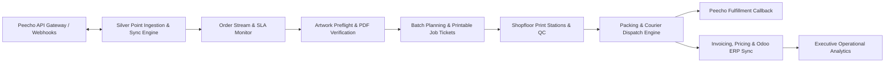
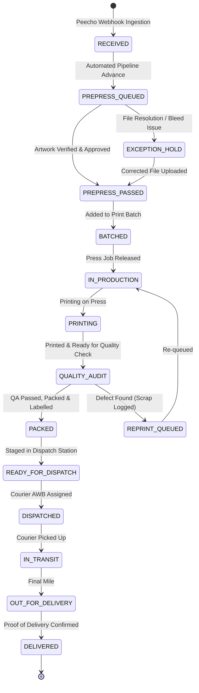

# Silver Point POD (ORDERFLOW) - Complete System & Module Documentation

This document provides complete architectural and module-by-module documentation for **Silver Point POD (ORDERFLOW)**, an enterprise Print-on-Demand (POD) Operations Portal and Bi-Directional **Peecho API Gateway**.

---

## 1. Executive Summary & System Overview

Silver Point POD is an end-to-end industrial software solution managing the complete physical lifecycle of print orders received from e-commerce channels and the **Peecho API Gateway**. It bridges automated cloud order ingestion with physical print shopfloor execution, quality assurance, multi-carrier parcel dispatch, and financial reconciliation.



### Core System Pillars
1. **Peecho Gateway Bi-Directional Integration**: Webhook ingestion for softcover/hardcover books, magazines, and photo products; automated real-time status and parcel tracking callbacks.
2. **SLA Countdown & Urgency Engine**: Dynamic priority tiers (`RUSH_8H`, `EXPRESS_24H`, `STANDARD_72H`) with live countdown clocks and visual breach warnings.
3. **Automated Preflight & Inspection**: Automated PDF dimensional checks, bleed validation, spine width verification, and manual approval/rejection workflows.
4. **Optimized Print Batching**: Grouping compatible orders by paper stock, trim size, and binding type with printable PDF job tickets and QR codes.
5. **Multi-Carrier Dispatch**: Native integrations for DHL, FedEx, Aramex, UPS, BlueDart, DTDC, and In-House / Own Delivery couriers with automated AWB generation.
6. **Multi-Tier Notification & Real-Time Auto-Sync**: In-app Notification Center popover, category filtering, floating toast alerts, and 4–5 second real-time polling.
7. **Role-Based Access Control (RBAC)**: Station-specific access guards and immutable staff audit logging.

---

## 2. Technology Stack & Infrastructure

### 2.1 Backend Architecture
* **Framework**: Django 5.1+ & Django REST Framework (DRF)
* **Language**: Python 3.12+
* **Database**: PostgreSQL (Production) / SQLite (Local Development)
* **Background Tasks & Workers**: Celery with Redis broker and `CELERY_ALWAYS_EAGER` fallback
* **API Documentation**: OpenAPI 3.0 / Swagger & Redoc powered by `drf-spectacular`
* **Document Generation**: ReportLab for dynamic PDF Job Tickets, work orders, and packing slips
* **HTTP Client**: `requests` with sandbox fallback resilience

### 2.2 Frontend Architecture
* **Framework**: Next.js 16 (App Router with Turbopack)
* **UI Library**: React 19, TypeScript 5
* **Styling**: Tailwind CSS 4, Custom CSS Design Tokens, Lucide Icons
* **Data Fetching & State**: TanStack React Query v5 (automatic polling, cache invalidation)
* **Visual Analytics**: Recharts 3 (Area charts, Bar charts, Pie charts)
* **Global Systems**:
  * Top navigation route progress bar ([`top-loader.tsx`](file:///Users/mintothomas/Works/anti-gravity/SIlverPointPOD/frontend/src/components/layout/top-loader.tsx))
  * Full-screen and route skeleton loading ([`loading.tsx`](file:///Users/mintothomas/Works/anti-gravity/SIlverPointPOD/frontend/src/app/%28dashboard%29/loading.tsx))
  * Live Notification Center popover & toasts ([`notification-context.tsx`](file:///Users/mintothomas/Works/anti-gravity/SIlverPointPOD/frontend/src/context/notification-context.tsx))

### 2.3 Network Ports & Runtime Services
| Service | Host & Port | Description |
| :--- | :--- | :--- |
| **Django REST Backend** | `http://127.0.0.1:8000/` | Core REST API, Swagger UI (`/api/docs/swagger/`), Django Admin (`/admin/`) |
| **Backend Proxy** | `http://127.0.0.1:8001/` | Forwarding proxy forwarding requests to port 8000 |
| **Next.js Frontend** | `http://localhost:3000/` | Next.js operations portal |

---

## 3. End-to-End Operational Lifecycle & State Machine

Every order traverses a strict state machine governed by dynamic `EntityStatus` definitions:



### Bi-Directional Peecho Status Mapping
Internal Silver Point milestone changes are mapped and pushed to Peecho API:

| Internal Code | Internal Status Name | Peecho Remote Status | Notes |
| :--- | :--- | :--- | :--- |
| `RECEIVED` | Order Received | `RECEIVED` | Initial ingest acknowledgement |
| `PREPRESS_QUEUED` | Prepress Queued | `IN_PREFLIGHT` | PDF artwork under inspection |
| `PREPRESS_PASSED` | Prepress Approved | `ARTWORK_VERIFIED` | Verified trim, bleed, spine width |
| `BATCHED` | Batched for Production | `BATCHED_FOR_PRODUCTION` | Order assigned to print batch ticket |
| `IN_PRODUCTION` | In Production | `IN_PRODUCTION` | Queued in press room |
| `PRINTING` | Printing on Press | `PRINTING` | Actively printing covers & interiors |
| `QUALITY_AUDIT` | Quality Audit | `QUALITY_AUDIT` | Finishing & bindery QC |
| `PACKED` / `PRODUCTION_COMPLETED` | Packed & Labelled | `PRODUCTION_COMPLETED` | Packaging finalized |
| `READY_FOR_DISPATCH` | Ready for Dispatch | `READY_FOR_DISPATCH` | Waiting for courier pickup |
| `DISPATCHED` | Dispatched | `DISPATCHED` | Dispatched with tracking number & AWB |
| `IN_TRANSIT` | In Transit | `IN_TRANSIT` | In courier transit |
| `OUT_FOR_DELIVERY` | Out for Delivery | `OUT_FOR_DELIVERY` | Out for final mile delivery |
| `DELIVERED` | Delivered | `DELIVERED` | Order delivered |
| `EXCEPTION_HOLD` | Exception Hold | `ON_HOLD` | Artwork or address exception |
| `REPRINT_QUEUED` | Reprint Queued | `REPRINT_QUEUED` | Damage detected; reprint initiated |
| `CANCELLED` | Cancelled | `CANCELLED` | Cancelled before production |

---

## 4. Backend Module-by-Module Breakdown

```
backend/
├── apps/
│   ├── authentication/   # Staff users, dynamic roles, JWT, session, audit trail
│   ├── core/             # Dynamic EntityStatus engine, base models, lookups
│   ├── orders/           # Ingestion, Peecho config, status updates, SLA calculation
│   ├── prepress/         # Prepress inspection, PDF verification, preflight rules
│   ├── production/       # Batching engine, Job ticket PDF generation, print jobs
│   ├── dispatch/         # Shipments, carrier definitions, tracking, Peecho callback
│   ├── shopfloor/        # Mobile scan stations, operator events
│   ├── finance/          # Customer invoices, pricing tiers, quote calculator
│   └── analytics/        # Throughput, SLA monitors, scrap logs, Odoo ERP sync
├── config/               # Settings (base, local, production), URLs, WSGI, Celery
└── requirements.txt
```

---

### 4.1 Authentication & RBAC (`apps.authentication`)

#### Models
* **`User`** (`apps.authentication.models.User`):
  * Custom staff user model extending `AbstractUser`.
  * Fields: `id` (UUID), `email` (unique identifier), `first_name`, `last_name`, `employee_id`, `department`, `phone_number`, `avatar_url`, `role` (ForeignKey &rarr; `SystemRole`), `last_activity_at`.
* **`SystemRole`** (`apps.authentication.models.SystemRole`):
  * Operational roles: `SUPER_ADMIN`, `ADMIN`, `PREPRESS_SPECIALIST`, `PRODUCTION_MANAGER`, `SHOPFLOOR_OPERATOR`, `DISPATCH_FINANCE_SPECIALIST`.
  * Fields: `name`, `code`, `description`, `is_system_role`, `permissions` (JSON array of allowed slugs).
* **`UserAuditLog`** (`apps.authentication.models.UserAuditLog`):
  * Immutable record of staff operations.
  * Fields: `user`, `user_name`, `user_email_snapshot`, `action`, `resource_type`, `resource_id`, `details` (JSON), `ip_address`, `user_agent`, `created_at`.

#### Key APIs
| Endpoint | Method | Description |
| :--- | :--- | :--- |
| `/api/v1/auth/login/` | `POST` | Authenticate with email/password; returns user profile and access token |
| `/api/v1/auth/logout/` | `POST` | Invalidates active user session and logs staff logout |
| `/api/v1/auth/me/` | `GET` | Returns currently authenticated user context and role details |
| `/api/v1/auth/staff/` | `GET`, `POST` | List all staff members or invite a new staff user |
| `/api/v1/auth/staff/<id>/assign-role/` | `POST` | Assign operational role and station permissions |
| `/api/v1/auth/audit-logs/` | `GET` | Filter and inspect system-wide staff audit trail |

---

### 4.2 Core & Dynamic Status Engine (`apps.core`)

#### Models
* **`TimeStampedModel`**: Abstract base model providing `id` (UUID), `created_at`, `updated_at`, and `is_active`.
* **`EntityStatus`** (`apps.core.models.EntityStatus`):
  * Dynamic milestone configuration defining statuses for entities: `ORDER`, `PRINT_JOB`, `PEECHO_SYNC`, `SHIPMENT`, `BATCH`.
  * Fields: `entity_type`, `code`, `name`, `badge_color`, `badge_bg`, `badge_text`, `sort_order`, `is_terminal`, `is_failure_state`, `allowed_transitions`.

#### Key APIs
| Endpoint | Method | Description |
| :--- | :--- | :--- |
| `/api/v1/core/statuses/` | `GET` | Retrieve dynamic statuses filtered by `entity_type` (e.g. `?entity_type=ORDER`) |
| `/api/v1/core/roles/` | `GET` | List dynamic roles and station access definitions |

---

### 4.3 Orders & Peecho Gateway Ingestion (`apps.orders`)

#### Models
* **`Order`** (`apps.orders.models.Order`):
  * Core print job order record.
  * Fields: `order_number` (`SP-YYYY-NNNNN`), `peecho_order_id`, `customer_name`, `customer_email`, `customer_phone`, `shipping_address` (JSON), `carrier_preference`, `status` (FK &rarr; `EntityStatus`), `sla_deadline`, `sla_priority` (`RUSH_8H`, `EXPRESS_24H`, `STANDARD_72H`), `total_items_count`, `total_amount`, `currency`, `peecho_metadata` (stores `last_peecho_sync`, raw payload).
* **`OrderItem`** (`apps.orders.models.OrderItem`):
  * Individual product in an order.
  * Fields: `order`, `peecho_item_id`, `product_type`, `quantity`, `page_count`, `spine_width_mm`, `paper_stock`, `pdf_artwork_url`, `pdf_cover_url`, `preflight_passed`, `metadata`.
* **`PeechoIntegrationConfig`** (`apps.orders.models.PeechoIntegrationConfig`):
  * Singleton gateway credentials.
  * Fields: `api_base_url`, `api_key`, `button_key`, `webhook_secret`, `is_sandbox`, `auto_sync_status_changes`, `sync_on_dispatch`.
* **`PeechoPayloadLog`** (`apps.orders.models.PeechoPayloadLog`):
  * Ingested raw payload archive for traceability and debugging.

#### Business Logic & Services
* **`sync_order_status_to_peecho(order, status_code, notes, operator)`**:
  * Pushes order transitions directly to Peecho API. In sandbox/offline mode, it returns verified mock confirmations while updating `order.peecho_metadata["last_peecho_sync"]` with timestamp, status, and response code.
* **`simulate_peecho_order(priority)`**:
  * Ingests a production-grade sample order with interior and cover PDFs, realistic customer addresses, and calculated SLA deadlines.

#### Key APIs
| Endpoint | Method | Description |
| :--- | :--- | :--- |
| `/api/v1/orders/` | `GET` | List orders; supports search, `urgency` filter, and comma-separated status codes (e.g. `?status=PACKED,READY_FOR_DISPATCH`) |
| `/api/v1/orders/<id>/` | `GET` | Full order details with items and metadata |
| `/api/v1/orders/<id>/status/` | `POST`, `PATCH` | Transitions order status, updates linked shipments, triggers Peecho auto-sync, logs audit record |
| `/api/v1/orders/<id>/audit-logs/` | `GET` | Order-specific timeline history |
| `/api/v1/orders/metrics/` | `GET` | KPI metrics (Active orders, SLA breaches, in-production count) |
| `/api/v1/orders/simulate-webhook/` | `POST` | Ingests simulated order with selected priority tier |
| `/api/v1/peecho/orders/webhook/` | `POST` | Live Peecho webhook ingestion endpoint |
| `/api/v1/peecho/config/` | `GET`, `PUT` | Configure gateway credentials and auto-sync toggles |

---

### 4.4 Prepress & Artwork Preflight (`apps.prepress`)

#### Models
* **`PrepressJob`** (`apps.prepress.models.PrepressJob`):
  * Tracks artwork inspection for an order.
  * Fields: `order`, `status`, `assigned_to`, `page_count_actual`, `bleed_margin_mm`, `spine_width_mm`, `is_cmyk`, `dpi_resolution`, `has_trim_boxes`, `preflight_errors` (JSON array), `verified_at`, `notes`.
* **`ArtworkVerification`**:
  * Checkpoints recorded per file.

#### Business Logic & Services
* Automated preflight engine checks:
  * Interior & Cover PDF resolution (must be &ge; 300 DPI).
  * Color space verification (CMYK check).
  * Bleed margins (&ge; 3mm on all trim edges).
  * Spine width calculated according to paper stock bulk factor:
    $$\text{Spine Width (mm)} = \left(\frac{\text{Page Count}}{2}\right) \times \text{Caliper Factor} + \text{Hinge Allowance}$$

#### Key APIs
| Endpoint | Method | Description |
| :--- | :--- | :--- |
| `/api/v1/prepress/jobs/` | `GET` | List preflight jobs with filter by preflight status |
| `/api/v1/prepress/jobs/<id>/` | `GET` | Detailed file specs, bleed analysis, and PDF download links |
| `/api/v1/prepress/jobs/<id>/approve/` | `POST` | Approves artwork, sets order status to `PREPRESS_PASSED`, pushes update to Peecho |
| `/api/v1/prepress/jobs/<id>/reject/` | `POST` | Rejects artwork with reason notes, places order on `EXCEPTION_HOLD` |

---

### 4.5 Production Batching & Job Tickets (`apps.production`)

#### Models
* **`ProductionBatch`** (`apps.production.models.ProductionBatch`):
  * Grouping of orders sharing paper stock and trim attributes.
  * Fields: `batch_number` (`BATCH-YYYYMMDD-NNN`), `paper_stock`, `binding_type`, `machine_assigned`, `target_completion`, `status`, `total_items`, `total_sheets`.
* **`BatchItem`** (`apps.production.models.BatchItem`):
  * Links `OrderItem` to `ProductionBatch` with imposed sheet position.

#### Business Logic & Services
* **`generate_job_ticket_pdf(batch_id)`**:
  * ReportLab PDF rendering engine creating industrial job tickets.
  * Includes batch barcode/QR code, imposition parameters, total sheet count, paper caliper specs, binding guidelines, and item checklist table.

#### Key APIs
| Endpoint | Method | Description |
| :--- | :--- | :--- |
| `/api/v1/production/batches/` | `GET`, `POST` | List active batches or create a new batch |
| `/api/v1/production/batches/auto-group/` | `POST` | Analyzes unbatched orders and suggests optimized groupings |
| `/api/v1/production/batches/<id>/` | `GET` | Batch details and item list |
| `/api/v1/production/batches/<id>/download-ticket/` | `GET` | Direct PDF download of printable industrial job ticket |
| `/api/v1/production/batches/<id>/advance/` | `POST` | Advances batch status (`BATCHED` &rarr; `IN_PRODUCTION` &rarr; `PRODUCTION_COMPLETED`) |

---

### 4.6 Packing & Dispatch (`apps.dispatch`)

#### Models
* **`Shipment`** (`apps.dispatch.models.Shipment`):
  * Fulfillable package parcel record.
  * Fields: `order`, `carrier_name`, `carrier_code`, `tracking_number`, `tracking_url`, `awb_document_url`, `weight_kg`, `package_type`, `shipping_cost`, `currency`, `status` (FK &rarr; `EntityStatus`), `status_code`, `carrier_events_log` (JSON timeline), `dispatched_by`, `dispatched_at`, `actual_delivered_at`, `peecho_synced`, `peecho_sync_response`.

#### Carrier Definitions
* `SELF_DELIVERY`: Own Delivery Person / In-House Driver (Same-Day Direct Delivery)
* `DHL`: DHL Express Worldwide (1–3 Days International)
* `FEDEX`: FedEx Priority Express (2–4 Days)
* `ARAMEX`: Aramex International (3–5 Days)
* `UPS`: UPS Worldwide Express (2–4 Days)
* `BLUEDART`: BlueDart Domestic Express (1–2 Days)
* `DTDC`: DTDC Express (2–3 Days)

#### Business Logic & Services
* **`sync_shipment_to_peecho(shipment_id)`**:
  * Sends courier name, tracking number, tracking URL, and timestamp back to Peecho fulfillment endpoint.
  * Uses active `PeechoIntegrationConfig` with sandbox resilience.

#### Key APIs
| Endpoint | Method | Description |
| :--- | :--- | :--- |
| `/api/v1/dispatch/shipments/` | `GET` | List dispatched shipments with tracking timelines |
| `/api/v1/dispatch/confirm/` | `POST` | Confirms packing & parcel dispatch, updates order to `DISPATCHED`, creates shipment, triggers Peecho callback |
| `/api/v1/dispatch/shipments/<id>/update-milestone/` | `POST` | Advances delivery status (`IN_TRANSIT`, `OUT_FOR_DELIVERY`, `DELIVERED`) and updates tracking log |
| `/api/v1/dispatch/shipments/<id>/retry-sync/` | `POST` | Retries Peecho tracking synchronization |

---

### 4.7 Finance, Invoicing & Pricing (`apps.finance`)

#### Models
* **`MonthlyInvoice`** (`apps.finance.models.MonthlyInvoice`):
  * Periodic customer/channel invoice grouping fulfilled orders.
  * Fields: `invoice_number`, `client_name`, `billing_period_start`, `billing_period_end`, `subtotal`, `tax_amount`, `total_amount`, `currency`, `payment_status` (`DRAFT`, `ISSUED`, `PAID`, `OVERDUE`).
* **`ProductPricing`** (`apps.finance.models.ProductPricing`):
  * Base print price matrices by page count, cover stock, and binding method.
* **`CostLossLog`** (`apps.finance.models.CostLossLog`):
  * Scrap loss logging for damaged or reprinted copies.

#### Key APIs
| Endpoint | Method | Description |
| :--- | :--- | :--- |
| `/api/v1/finance/invoices/` | `GET` | List monthly billing invoices |
| `/api/v1/finance/calculator/` | `POST` | Quote calculator based on product type, page count, binding, and quantity |
| `/api/v1/finance/pricing/` | `GET` | Base price list per product type |

---

### 4.8 Analytics, SLA & Odoo ERP Integration (`apps.analytics`)

#### Models
* **`OdooSyncLog`** (`apps.analytics.models.OdooSyncLog`):
  * Sync log records between Silver Point and Odoo ERP (Accounting & Stock).
* **`SLAAlertLog`** (`apps.analytics.models.SLAAlertLog`):
  * Logged warnings for orders nearing SLA breach (&lt; 4 hours remaining).
* **`ReprintDamageLog`** (`apps.analytics.models.ReprintDamageLog`):
  * Station defect records detailing damaged quantity, waste sheets count, and estimated cost loss.

#### Key APIs
| Endpoint | Method | Description |
| :--- | :--- | :--- |
| `/api/v1/analytics/dashboard/` | `GET` | Operations KPIs: throughput, on-time delivery rate, scrap costs, courier breakdown |
| `/api/v1/analytics/report-damage/` | `POST` | Submits shopfloor reprint/scrap report and initiates reprint order |
| `/api/v1/analytics/odoo-sync/` | `POST` | Triggers Odoo sync for orders, shipments, or stock movements |

---

## 5. Frontend Architecture & Module-by-Module Breakdown

```
frontend/src/
├── app/
│   ├── (auth)/login/             # Staff login & authentication
│   ├── (dashboard)/
│   │   ├── layout.tsx            # Main shell: Sidebar, Header, RBAC Guard, Notifications
│   │   ├── loading.tsx           # Skeleton loading state for station transitions
│   │   ├── overview/             # Executive analytics & scrap reporting
│   │   ├── orders/               # Order stream, 5xl detail modal, SLA clocks
│   │   ├── prepress/             # Artwork inspection & approval/rejection
│   │   ├── production/batching/  # Print batch planning & Job Ticket downloads
│   │   ├── dispatch/             # Packing station, Ready to Ship queue, courier AWB
│   │   ├── finance/              # Monthly invoices & quote calculator
│   │   ├── peecho/               # Peecho Gateway settings & simulator
│   │   ├── staff/                # Staff directory, RBAC matrix, audit log history
│   │   ├── shopfloor/            # Workstation scan station
│   │   └── lookups/              # Dynamic entity status & role management
│   ├── layout.tsx                # Root layout (Inter font, metadata)
│   ├── loading.tsx               # Root splash screen loader
│   └── providers.tsx             # TanStack Query, LoaderProvider, TopLoader
├── components/
│   ├── layout/                   # Sidebar, Header (Notification Center), TopLoader, AccessGuard
│   └── ui/                       # Badge, Button, Card, Modal, StatCard, Table
├── context/
│   ├── notification-context.tsx  # In-app notifications, toasts, unread counts
│   └── loader-context.tsx        # Programmatic full-screen loader overlay
└── services/api/                 # Axios API service clients
```

---

### 5.1 Global Systems & Layout Shell

#### 1. Top Route Navigation Loader ([`top-loader.tsx`](file:///Users/mintothomas/Works/anti-gravity/SIlverPointPOD/frontend/src/components/layout/top-loader.tsx))
* A 3px gradient progress bar (`#0073EA` Royal Blue &rarr; `#38BDF8` Cyan &rarr; `#00C875` Emerald) with a glowing pulse.
* Intercepts internal link clicks to give instant feedback on click, completing and fading smoothly as the route finishes loading.

#### 2. Station Skeleton Loader ([`(dashboard)/loading.tsx`](file:///Users/mintothomas/Works/anti-gravity/SIlverPointPOD/frontend/src/app/%28dashboard%29/loading.tsx))
* Preserves the navigation sidebar and header while displaying shimmering card skeletons and station loaders when switching modules.

#### 3. Live Notification Center & Floating Toasts ([`header.tsx`](file:///Users/mintothomas/Works/anti-gravity/SIlverPointPOD/frontend/src/components/layout/header.tsx), [`notification-context.tsx`](file:///Users/mintothomas/Works/anti-gravity/SIlverPointPOD/frontend/src/context/notification-context.tsx))
* **Header Popover Dropdown**:
  * Unread badge counter with animated indicator.
  * Category tabs: **All**, **Status Sync**, **SLA Alerts**, and **Dispatch**.
  * Relative timestamps ("Just now", "5m ago"), one-click dismiss, and "Mark all read".
  * Live status indicator: *"Peecho Auto-Sync Active"*.
* **Floating Toast Alerts**: Top-right animated notifications for status changes, dispatches, and incoming orders.

#### 4. Role-Based Access Guard ([`access-guard.tsx`](file:///Users/mintothomas/Works/anti-gravity/SIlverPointPOD/frontend/src/components/layout/access-guard.tsx))
* Protects stations against unauthorized staff roles. If an unauthorized URL is visited, an access-restricted screen is shown with a shortcut to the user's assigned station.

---

### 5.2 Module Views

#### 1. Overview Dashboard ([`/overview`](file:///Users/mintothomas/Works/anti-gravity/SIlverPointPOD/frontend/src/app/(dashboard)/overview/page.tsx))
* **Live KPIs**: Total Orders, In Production, Ready for Dispatch, SLA On-Time %, Scrap Loss Cost.
* **Charts**: 7-day throughput area chart, order volume by product type, courier distribution pie chart.
* **Reprint / Scrap Loss Reporter**: Modal to report damaged copies with waste sheets count, cost estimation, and automatic reprint queueing.
* **Odoo Sync Status**: Live telemetry showing sync timestamps for accounting and inventory.

#### 2. Order Flow & Details ([`/orders`](file:///Users/mintothomas/Works/anti-gravity/SIlverPointPOD/frontend/src/app/(dashboard)/orders/page.tsx))
* **Live Orders Table**: Search by customer name, order number, or Peecho ID; filter by SLA urgency (`CRITICAL`, `URGENT`, `NORMAL`, `BREACHED`).
* **SLA Countdown Clocks**: Real-time ticking timers showing remaining hours and minutes until delivery deadline.
* **Expanded View Order Modal (`maxWidth="5xl"`)**:
  * Delivery deadline countdown banner and courier preference.
  * Direct downloads for Book Interior (PDF) and Book Cover (PDF).
  * Customer contact details and complete shipping address.
  * Quick Status action buttons (`Artwork Approved`, `Start Printing`, `Production Done`, `Out for Delivery`, `Mark Delivered`, `Put on Hold`).
  * Manual Status Dropdown selector showing current status.
  * Live confirmation alert banner displaying auto-sync timestamp with Peecho Gateway.
  * Complete audit trail history tab showing every staff update.
* **Simulation Webhook**: Test button to ingest sample orders with selected priority (`RUSH_8H`, `EXPRESS_24H`, `STANDARD_72H`).

#### 3. Artwork & Prepress ([`/prepress`](file:///Users/mintothomas/Works/anti-gravity/SIlverPointPOD/frontend/src/app/(dashboard)/prepress/page.tsx))
* **Inspection Queue**: Displays incoming orders requiring preflight validation.
* **Automated Specs Checklist**: Bleed margins (&ge; 3mm), trim box coordinates, CMYK color space verification, image resolution check (&ge; 300 DPI), spine width calculation.
* **File View & Actions**: Direct download links for interior and cover files, **Approve Artwork** button, and **Reject Artwork** button with notes input.

#### 4. Print Batches & Job Tickets ([`/production/batching`](file:///Users/mintothomas/Works/anti-gravity/SIlverPointPOD/frontend/src/app/(dashboard)/production/batching/page.tsx))
* **Batch Planning Board**: Grouping orders by paper stock and binding type.
* **Automated Grouping Engine**: Recommends batches that maximize press utilization and minimize paper changeover time.
* **Industrial Job Ticket**:
  * One-click download of printable PDF Job Ticket via ReportLab backend.
  * Includes batch QR code, press instructions, sheet imposition layout, and order item checklist.
* **Batch Advancement**: Tracks progress from `BATCHED` &rarr; `IN_PRODUCTION` &rarr; `PRODUCTION_COMPLETED`.

#### 5. Packing & Shipping Station ([`/dispatch`](file:///Users/mintothomas/Works/anti-gravity/SIlverPointPOD/frontend/src/app/(dashboard)/dispatch/page.tsx))
* **Dispatch Workbench**:
  * Order search by order number or Peecho ID.
  * Carrier selection dropdown: `Own Delivery Person (In-House Driver)`, `DHL Express Worldwide`, `FedEx Priority`, `Aramex International`, `UPS Worldwide`, `BlueDart`, `DTDC`.
  * Auto-generation of tracking numbers (`DELIVERY-SP-...` for in-house driver; courier tracking numbers for express carriers).
  * Parcel weight input, package type selection (Bubble Mailer, Book Box, Pallet), and shipping cost.
* **Ready to Ship Queue (Real-Time Auto-Sync)**:
  * Automatically polls every 4 seconds (`refetchInterval: 4000`) for orders with status `PACKED` or `READY_FOR_DISPATCH`.
  * Live pulsing green **"Auto-sync"** badge.
  * Manual refresh button with spinning icon.
  * Quick-pick chips to populate the dispatch form with one click.
* **Dispatched Shipments Table**:
  * Real-time list of all shipments with courier name and tracking links.
  * Interactive tracking timeline modal showing milestone events.
  * Milestone updater (`IN_TRANSIT`, `OUT_FOR_DELIVERY`, `DELIVERED`).
  * One-click retry sync button for Peecho tracking callbacks.

#### 6. Invoices, Pricing & Finance ([`/finance`](file:///Users/mintothomas/Works/anti-gravity/SIlverPointPOD/frontend/src/app/(dashboard)/finance/page.tsx))
* **Monthly Customer Invoices**: Invoices broken down by billing cycle, total amount, tax, and payment status.
* **Interactive Quote Calculator**: Calculates manufacturing and delivery costs based on product type, page count, binding method, and quantity.
* **Price Tier Matrices**: Base price schedules across standard book sizes (A4, A5, Square) and bindings (Hardcover, Softcover, Wire-O).

#### 7. Peecho API Gateway Configuration ([`/peecho`](file:///Users/mintothomas/Works/anti-gravity/SIlverPointPOD/frontend/src/app/(dashboard)/peecho/page.tsx))
* **Gateway Controls**: API Base URL, API Key, Button Key, and Webhook Secret configuration.
* **Sync Policy Toggles**: Auto-sync status changes toggle, sync-on-dispatch toggle, sandbox mode switch.
* **Live Ingestion Simulator**: Trigger simulated webhooks directly from the UI.
* **Gateway Logs**: Raw payload log table showing timestamps, remote response codes, and sync latency.

#### 8. Staff Accounts & Access Management ([`/staff`](file:///Users/mintothomas/Works/anti-gravity/SIlverPointPOD/frontend/src/app/(dashboard)/staff/page.tsx))
* **Employee Directory**: Staff listing with employee IDs, avatar initials, department, phone number, and active role.
* **User Onboarding**: Modal to create staff accounts and assign initial roles.
* **Role & Station Assignment**: Modify staff roles with instant permission updates.
* **System Audit Log Viewer**: Complete log of all user operations across the platform with filtering by action type.

---

## 6. Security, RBAC & Audit Architecture

### 6.1 Role-Based Permissions Matrix
| Operational Station / Page | Super Admin | Admin | Prepress Specialist | Production Manager | Shopfloor Operator | Dispatch & Finance |
| :--- | :---: | :---: | :---: | :---: | :---: | :---: |
| **Overview Dashboard** (`/overview`) | Yes | Yes | Yes | Yes | Yes | Yes |
| **Orders Stream** (`/orders`) | Yes | Yes | Yes | Yes | Yes | Yes |
| **Artwork & Prepress** (`/prepress`) | Yes | Yes | Yes | Yes | No | No |
| **Print Batches** (`/production/batching`) | Yes | Yes | No | Yes | Yes | No |
| **Shipping & Tracking** (`/dispatch`) | Yes | Yes | No | No | No | Yes |
| **Invoices & Finance** (`/finance`) | Yes | Yes | No | No | No | Yes |
| **Peecho Gateway** (`/peecho`) | Yes | Yes | No | No | No | No |
| **Staff Accounts** (`/staff`) | Yes | Yes | No | No | No | No |
| **Lookups & Roles** (`/lookups`) | Yes | Yes | No | No | No | No |

### 6.2 Audit Trail Enforcement
All sensitive operational actions trigger `log_staff_action`:
* Actions logged: `STATUS_CHANGE`, `CONFIRM_DISPATCH`, `SHIPMENT_MILESTONE_UPDATE`, `APPROVE_ARTWORK`, `REJECT_ARTWORK`, `CREATE_BATCH`, `DOWNLOAD_JOB_TICKET`, `REPORT_SCRAP_DAMAGE`, `PEECHO_STATUS_SYNC`, `ASSIGN_STAFF_ROLE`.
* Recorded attributes: `user_id`, `user_email_snapshot`, `resource_type`, `resource_id`, `details` JSON, `ip_address`, `timestamp`.

---

## 7. Developer & Operations Runbook

### 7.1 Local Environment Setup

#### Prerequisites
* Python 3.12+ with `virtualenv`
* Node.js 18+ (Node 20+ recommended) with `npm`

#### Backend Setup
```bash
cd backend

# Create and activate virtual environment
python3 -m venv .venv
source .venv/bin/activate

# Install dependencies
pip install -r requirements.txt

# Run database migrations
python manage.py migrate

# Seed initial operational data (Statuses, Roles, Sample Orders, Admin User)
python manage.py seed_initial_data

# Start Django development server on port 8000
python manage.py runserver 127.0.0.1:8000
```

#### Frontend Setup
```bash
cd frontend

# Install npm dependencies
npm install

# Validate TypeScript and production build
npm run build

# Start Next.js development server on port 3000
npm run dev
```

### 7.2 Default Admin Credentials
* **Email**: `admin@silverpointpod.com`
* **Password**: `Admin@123456`
* **Role**: `SUPER_ADMIN` / Executive Management

---

## 8. Verification & Smoke Testing Matrix

| Component | Test Procedure | Expected Result |
| :--- | :--- | :--- |
| **Peecho Order Ingestion** | Click *"Simulate Peecho Order"* in Orders or Peecho page | New order appears in table; notification toast fires; countdown clock begins |
| **Prepress Approval** | Go to `/prepress`, open job, click *"Approve Artwork"* | Status changes to `PREPRESS_PASSED`; Peecho sync confirms `ARTWORK_VERIFIED` |
| **Batch Job Ticket** | Go to `/production/batching`, click *"Download Job Ticket"* | ReportLab generates PDF with QR code, imposition layout, and order checklist |
| **Order Status Update** | In `/orders`, open order details, select new status, click *"Update Status"* | Floating toast fires; modal shows auto-sync banner; Peecho metadata updates |
| **Dispatch with Own Delivery** | Go to `/dispatch`, select `Own Delivery Person`, confirm dispatch | Order assigned to `Own Delivery Person (In-House Driver)`, tracking formatted as `DELIVERY-SP-...`, Peecho updated |
| **Ready to Ship Auto-Sync** | Advance an order to `PACKED` in `/orders`; observe `/dispatch` | Ready to Ship queue automatically increments without manual reload within 4s |
| **Notification Center** | Click Bell icon in header | Notification Center opens with unread count badge, category filters, and mark-all-read |
| **Global Loader** | Navigate between stations or reload page | Top route progress bar glows across top; station skeleton loads smoothly |
